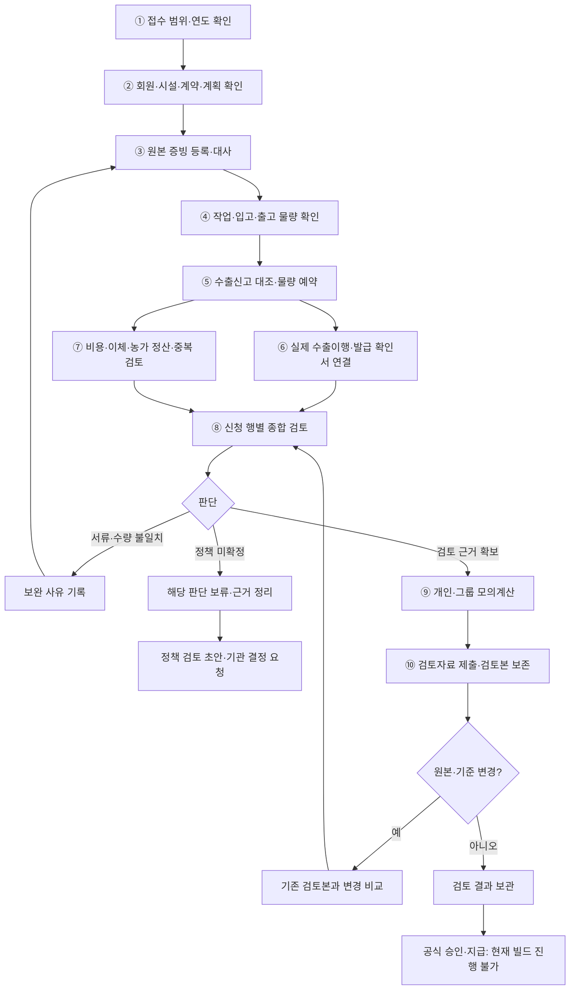

> 종전 설계·검토 기록 보관 문서입니다. 아래 메뉴·작성·결재·지급 절차는 현재 제품에서 종료되었습니다. 현재 사용법은 [공동선별비 정산 안내](../SETTLEMENT_WORKFLOW.md)를 따르세요.

# 통합조직 담당자 업무 흐름 및 단계별 검토표

작성일: 2026-11-23 · 대상: 현재 구축된 공동선별비 검토 기능

이 문서는 통합조직 담당자의 권장 업무 순서이다. 시스템이 모든 단계를 순서대로 강제하는 마법사라는 뜻은 아니다. 필요한 서류는 현재 구현된 검토 항목과 제공된 참고자료에 따른 수집 목록이며, 확정된 2027년 법정·공고상 필수 첨부 목록이 아니다. 제공 자료에서 확인되지 않은 필수 첨부 6종을 임의로 정하지 않았다.

현재 기능의 종착점은 **검토자료 제출 및 검토본 보존**이다. 공식 승인·보조금 지급·공식 출력은 차단되어 있다. 기존 수출실적 메뉴의 ‘제출자료’와 공동선별비의 ‘검토자료 제출’은 별개 업무이다.

## 1. 전체 흐름

⑥과 ⑦은 물량 예약 후 병행할 수 있다. 비용·계약 등 기초 기록은 앞서 준비할 수 있으며, 신청에 연결할 때 해당 버전·대상·기간을 다시 확인한다. 정책 미확정 항목이 있어도 나머지 사실관계 수집은 계속할 수 있지만, 이를 확정 적격·확정 지급액으로 바꾸지 않는다.

## 2. 단계별 담당자 실행표

### ① 접수 범위와 적용 연도 확인

- **받을 자료:** 접수 대상 목록, 회원·시설·품목·작업기간, 신청 예정 물량, 적용 사업연도, 적용 기준·공고 또는 결정자료가 있다면 해당 원본.
- **할 일:** 건별 식별정보를 정리하고 기존 수출실적 업무와 공동선별비 검토를 구분한다. 2026 참고 프로파일과 2027 초안 프로파일을 혼용하지 않는다.
- **판단:** 누구의 어느 시설·품목·기간을 검토하는가? 적용 연도와 프로파일이 일치하는가? 근거가 확정 자료인가, 검토 초안인가?
- **메뉴:** 회원사 명부 / 공동선별비 → 정책 검토.
- **다음 단계 기준:** 검토 대상을 식별할 수 있다. 근거가 미확정이면 그 상태를 기록한 채 사실자료 수집으로 진행한다.
- **보완·보류:** 연도·대상 불명확은 접수정보 보완. 지원대상·자격 기준일 미확정은 정책 판단 보류(P-01·02).

### ② 회원·시설·계약·계획 확인

- **받을 자료:** 회원 가입·승인·탈퇴 이력, 사업자 식별자료, 시설 지정 증빙과 유효기간, 계약서·변경계약, 연간·월간 계획과 변경 사유.
- **할 일:** 회원·시설 운영자·생산자·수출자 역할을 구분한다. 시설·품목·회원·지정기간을 원본과 대조한다. 계약의 당사자·물량·기간·가격·공제·정산기한을 기록한다.
- **판단:** 대상 시설과 회원이 일치하는가? 작업일이 지정기간과 어떤 관계인가? 계약이 해당 시설·품목·기간에 대응하는가? 변경 이력이 있는가?
- **메뉴:** 회원사 명부 / 시설·작업 / 비용·거래·생산.
- **다음 단계 기준:** 대상과 원본 근거를 연결하고 불일치·미확정 사유를 남긴다. 계약은 신청 행에서 해당 버전을 연결한다.
- **보완·보류:** 시설·계약 누락은 보완. 비표준 계약, 계획 미등록·초과만으로 자동 탈락시키지 않는다. 자격 기준일·동등 계약·계획 효과는 P-02·03·05 검토 대상이다.

### ③ 원본 증빙 등록 및 자료 대사

- **받을 자료:** 지정·계약·작업·신고·이행·비용·정산 관련 원본 Excel/PDF/이미지 및 필요한 CSV.
- **할 일:** 원본을 먼저 등록하고 증빙 ID를 기록한다. Excel은 공식 세부 시트와 행을 선택한다. 두 자료 대사는 원문 행·수량·차이를 확인하는 데 사용한다. PDF는 페이지별 원본과 추출값을 대조한다.
- **판단:** 합계·참고·조정 행을 중복 포함했는가? 공란을 0으로 바꿨는가? 같은 원본을 독립 자료 두 개로 오인했는가? OCR 추출값을 실제 원본과 확인했는가?
- **메뉴:** Excel·증빙 / 자료 대사 / PDF 증빙 대사 / 입고 CSV.
- **다음 단계 기준:** 사용할 원본과 행·페이지를 특정할 수 있고, 미확인 값은 미확인으로 남아 있다.
- **보완·보류:** 판독 불가·누락은 선명한 원본 또는 추가 자료로 보완한다. OCR 성공·표 간 일치만으로 실물·수출·비용 적격을 확정하지 않는다. 원본 재추출로 검토 기준이 바뀌면 다시 확인한다.

### ④ 작업·입고·선별·출고 물량 확인

- **받을 자료:** 선별 작업일지, 시설·품목·작업일·kg 수량 근거. 확장형은 생산자 입고자료, 선별·재선별 내역, 적합·내수·비상품·감모·보류 내역, 출고 근거.
- **할 일:** 기본형은 작업 및 근거 물량을 등록한다. 확장형은 입고 → 선별·재선별 → 출고 연결을 기록한다. CSV는 열 매핑과 미리보기 후 선택 행을 등록한다.
- **판단:** 입력량과 산출량 합계가 맞는가? 같은 물량을 중복 사용했는가? 출고가 선행 작업보다 빠른가? 기본 작업 수량만으로 생산자별 실물 추적까지 확인했다고 볼 수 있는가?
- **메뉴:** 시설·작업 / 비용·거래·생산 / 입고 CSV.
- **다음 단계 기준:** 신청에 연결할 작업 또는 출고와 현재 가용량을 확인한다.
- **보완·보류:** 수지 불일치·중복·일자 역전은 원본 대조 후 보완한다. 보류·이월 재고 재사용은 정책 미확정 상태에서 임의 허용하지 않는다(P-06·14).

### ⑤ 수출신고 대조 및 신청 물량 예약

- **받을 자료:** 수출신고 원본과 정정·버전 정보, 신고번호·품목란·순중량, 대응 작업·출고 자료. AWB/B/L은 운송 보조자료로 사용한다.
- **할 일:** 신고 후보의 전체 번호·검증문자·품목란·정정 이력을 확인한다. 신고와 작업/출고를 다대다로 배분하고 서버의 예약 성공을 확인한다.
- **판단:** 후보가 유일하고 실제 해당 신고인가? 신청량이 신고 순중량과 작업/출고 가용량 모두를 넘지 않는가? 기존 예약과 겹치지 않는가?
- **메뉴:** 신고 원장 / 수출 매칭·예약.
- **다음 단계 기준:** 신청 행과 수량이 서버에 저장되고 예약량이 확인된다. 화면에 임시로 추가한 목록은 예약 완료가 아니다.
- **보완·보류:** 불완전 번호·품목란 미확인·복수 후보는 확인 후 재처리한다. AWB 총중량으로 신고 순중량을 대체하지 않는다. 월별 비례·최솟값 계산만으로 실물 연결을 확정하지 않는다.

### ⑥ 실제 수출이행 및 발급 확인서 연결

- **받을 자료:** 실제 수출일을 확인할 수 있는 객관적 이행 자료, 실제 사무국 발급 공동정산 확인서 원본 및 발급주체·회원·시설·품목·기간·물량·중복 기재내용.
- **할 일:** 확인서 기록을 등록한 뒤 신청 행에 이행증빙과 확인서를 연결하고 대조 근거·사유를 남긴다. 계약 버전도 행별로 연결해 대상과 기간을 확인한다.
- **판단:** 계획일이나 원장 기재 선적일을 실제 이행일로 오인했는가? 확인서 대상과 기간이 일치하는가? 동일 확인서의 연결량이 확인물량을 넘는가? 새 계약·확인서 버전이 나왔는가?
- **메뉴:** Excel·증빙 / 비용·거래·생산 / 신청 검토.
- **다음 단계 기준:** 연결 근거를 보존하고 미확인 부분을 명시한다. 연결 완료는 로컬 검토기록이며 발급기관 인증 완료가 아니다.
- **보완·보류:** 운송 보조자료만으로 실제 수출일을 확정하지 않는다. 프로그램의 확인서 작성 참고 초안은 실제 발급 확인서를 대신하지 않는다. 2027 대체증빙·동등성은 P-04·06 검토 대상이다.

### ⑦ 비용·이체·농가 정산·중복지원 검토

- **받을 자료:** 비용 발생 원본, 선별 인건비 등 분리 근거, 기존 비용 지급 이체증빙·실패/취소/재이체 내역, 신청별 배부 근거, 생산자 정산서·공제·지급 증빙, 다른 사업 지원·사용 물량 원장과 출처.
- **할 일:** 시설·품목·귀속월별 비용을 기록하고 이체 상태와 배부 이력을 대사한다. 농가 정산의 매출·공제·수수료·조정·순지급액·기지급액·기한을 대조한다. 외부 중복은 원장 출처·연도·버전·대상 물량을 확인한다.
- **판단:** 선별비를 포장·운송·내수 비용과 분리할 수 있는가? 정상 이체가 실제 발생액을 초과하는가? 실패 후 재이체를 중복 합산했는가? 비용을 여러 신청에 초과 배부했는가? 같은 물량을 중복 차감했는가? 정산기한이 도래했는가?
- **메뉴:** 비용·거래·생산 / 비용 대사 / 신청 검토.
- **다음 단계 기준:** 인정 후보·제외·미확정을 구분하고, 비용별 배부 잔액과 초과액을 별도로 확인한다. 기록상 정상 이체나 정산 완료를 실제 은행 대사 완료로 표시하지 않는다.
- **보완·보류:** 비용 분리·이체·외부 원장 근거가 없으면 보완한다. 외부 자료가 없다는 이유로 ‘중복 없음’으로 처리하지 않는다. 미도래·미지급만으로 자동 제외하지 않는다. 비용·농가 환류·중복 범위는 P-10·11·12·13 판단이 남는다.

### ⑧ 신청 행별 종합 검토 및 보완 처리

- **받을 자료:** ①~⑦의 연결 결과, 검토 지적사항, 보완 회신과 변경 근거, 관련 제재 자료가 있는 경우 그 원본과 확정 여부.
- **할 일:** 신청별·행별 누락, 날짜·수량 불일치, 원본 변경, 초과 예약·배부를 확인한다. 보완·반려·철회 사유를 남기고 재검토한다.
- **판단과 조치:**
  - 서류·사실 확인 가능 → 해당 자료를 보완하고 관련 단계 재검토.
  - 정책에 따라 결론이 달라짐 → 정책 검토에 근거를 기록하고 최종 판단 보류.
  - 행 보완 → 해당 행의 예약 유지.
  - 행 반려 → 선택 행의 예약만 해제.
  - 신청 전체 철회·반려 → 해당 신청의 예약·비용 배부 해제 및 이력 보존.
- **메뉴:** 신청 검토 / 정책 검토.
- **다음 단계 기준:** 확인 사실, 미확인 사실, 정책 미확정 판단을 구분한 검토기록을 확보한다. 조사·심의 중 사건만으로 자동 감액하지 않는다(P-15).

### ⑨ 개인·그룹 모의계산

- **받을 자료:** 검토 물량 Q, 적용 단가 U의 근거와 연도, 확인된 비용 C, 산식·한도·절사 기준의 결정자료. 그룹 검토는 동일 시설·품목·월·연도와 가상 예산·기존 약정 입력의 근거.
- **할 일:** 개별 모의계산과 그룹 한도 검토를 수행한다. 그룹에 속한 전체 활성 신청을 함께 확인한다. 비용 공란과 확인된 0을 구분한다.
- **판단:** 2026 참고 단가를 2027 확정 단가로 썼는가? 산식·보조율을 임의 가정했는가? 그룹 전체를 포함했는가? 변경 원본·초과 배부·불명확 신고가 남았는가?
- **메뉴:** 모의계산 / 그룹 모의계산 / 정책 검토.
- **다음 단계 기준:** 계산 조건·근거·미확정 항목을 함께 보존한다. 결과는 참고액이며 실제 예산 예약·확정 지급액이 아니다.
- **보완·보류:** P-07·08·09·10이 미확정이면 확정 지급 판단을 하지 않는다. 복수 시설·월 신청에 비용 배분 근거가 없으면 그룹 검토 보완이 필요하다.

### ⑩ 검토자료 제출·보존 및 변경 대응

- **준비할 자료:** 검토 Excel, 검토용 인쇄 초안, 원본 증빙 목록, 행별 보완·보류 내역, 적용한 정책 초안·근거, 검토본 식별정보.
- **할 일:** 검토자료 제출 상태와 검토본 보존을 각각 확인한다. 보존 후 신고 정정·시설·계약·확인서·원본 증빙 등이 바뀌면 저장 당시와 현재를 비교한다. 보완 후 새 검토본을 남긴다.
- **판단:** 검토본에 원본 파일 자체가 모두 포함되었다고 오인했는가? 변경으로 중량·기간·적격성·가용량이 달라졌는가? 미확정 항목을 0 또는 예약량으로 채워 확정처럼 보이게 했는가?
- **메뉴:** 신청 검토 / 검토 통계. 기존 수출실적의 감사 자료·상세 검증 이력은 해당 업무 범위에 맞춰 참고한다.
- **완료 기준:** 검토 결과와 근거 위치, 미해결 사항, 변경 이력을 추적할 수 있다. 원본은 별도로 보존한다.
- **후속 처리:** 변경 비교가 자동 예약 조정·자동 환수·자동 승인까지 수행하지 않는다. 관련 사실관계와 정책을 재검토한다(P-14). 현재 빌드에서는 공식 승인·지급·공식 출력으로 진행하지 않는다.

## 3. 담당자 판단 경로 요약

| 상황 | 담당자 조치 | 현재 시스템 처리 또는 한계 |
| --- | --- | --- |
| 서류 누락·판독 불가 | 보완 요청, 사유 기록, 원본 재대조 | 검토기록과 원본 연결 유지 |
| 번호·품목란·수량 불일치 | 신고 원본·정정 내역 및 작업 원본 확인 | 후보 일치와 실제 이행 확인을 구분 |
| 물량 초과·중복 예약 | 가용량과 기존 예약 확인 후 배분 재검토 | 초과 저장 거절; 화면 임시 목록은 예약 아님 |
| 비용 초과 배부 | 비용별 발생·정상 이체·활성 배부 확인 | 비용별 잔액·초과액 분리; 다른 비용과 상계하지 않음 |
| 정책 근거 없음 | 쟁점·선택안·결정 필요 근거 정리 | 정책 초안 등록은 가능, 승인으로 전환하지 않음 |
| 제재 조사·심의 중 | 대상·범위·확정 여부 확인 | 자동 감액·탈락 근거로 사용하지 않음 |
| 검토 후 원본 변경 | 검토본 변경 비교 → 관련 단계 재검토 | 기존 검토본 보존, 자동 환수·예약 조정 아님 |
| 공식 승인·지급 요청 | 검토자료와 미해결 목록을 기관 절차에 전달 | 현재 빌드에서 승인·지급·공식 출력 차단 |

## 4. 건별 검토기록 작성 양식

아래 항목은 업무용 권장 기록이며 별도 구현된 시스템 필드라는 뜻은 아니다.

| 항목 | 기록할 내용 |
| --- | --- |
| 대상 | 건 식별번호 / 사업연도·프로파일 / 회원 / 시설 / 품목 / 작업기간 |
| 물량 | 신청 원물량 / 현재 예약량 / 신고번호·품목란·버전 / 작업·출고 ID |
| 근거 | 증빙 ID / 원본 파일·시트·행·페이지 / 계약·확인서 버전 |
| 비용·정산 | 비용 귀속월 / 발생·정상 이체·배부액 / 농가 정산기한·기지급 기록 |
| 판단 | 확인 사실 / 미확인 사실 / 정책 판단 보류(P 번호) |
| 후속 조치 | 보완 대상·내용·회신기한 / 재검토일 / 행별 예약 유지·해제 여부 |
| 보존 | 검토자료 제출 여부 / 검토본 ID / 변경 비교 결과 / 보관 위치 |

보완 회신기한은 기관이 정하는 업무기한을 기록하며 임의의 법정 기한을 적용하지 않는다. 시스템의 검토 표기자는 독립 인증된 심사·승인권자를 의미하지 않는다.

## 5. 현재 자료의 해석과 참조

- **2026 참고자료:** 물량 산정·서식·발급 확인서 등의 참고 근거. 2027 확정 기준으로 자동 승계하지 않는다.
- **2027 검토 문서·마스터 프롬프트:** 구현·검토 요구사항과 정책 쟁점의 근거. 문서 안의 정책안 자체를 기관의 확정 지시로 간주하지 않는다.
- **현재 구현 근거:** [사용법](USER_MANUAL.md), [최신 구현 분석](IMPLEMENTATION_AUDIT_AND_ORDER.md), [정책 등록부](POLICY_REGISTER.md), [비용 대사](COST_RECONCILIATION.md), [생산 물량 검토](PRODUCTION_REVIEW.md), [PDF 페이지 대조](PDF_PAGE_REVIEW.md), [입고 CSV](INTAKE_CSV_IMPORT.md), [검토 통계](REVIEW_DASHBOARD.md).
- **실제 메뉴 화면:** [주요 메뉴 캡처 모음](../../output/menu-captures/index.html). 화면 예시 데이터는 합성 자료이다.

이 문서는 현재 빌드의 업무 안내를 정리한 것이며 제품 기능·정책·운영 승인 상태를 변경하지 않는다.
